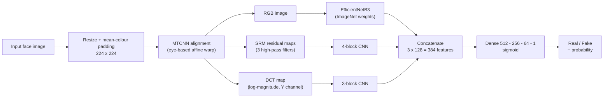

# Deepfake Image Detection Using Deep Learning

**A three-branch forensic CNN that classifies face images as real or fake by combining what the image looks like (RGB), the noise it leaves behind (SRM residuals) and its frequency fingerprint (DCT).**


| Test AUC-ROC | Test accuracy | Fake recall | Real recall | Test images |
|:---:|:---:|:---:|:---:|:---:|
| **0.92** | **83.5%** (threshold 0.4191) | 0.87 | 0.80 | 3,776 |

---

## Contents

- [Overview](#overview)
- [How it works](#how-it-works)
- [Results](#results)
- [Dataset](#dataset)
- [Getting started](#getting-started)
- [Training configuration](#training-configuration)
- [Limitations and responsible use](#limitations-and-responsible-use)
- [Future work](#future-work)
- [References](#references)
- [Author and citation](#author-and-citation)

---

## Overview

Modern face-synthesis methods produce images that people can no longer reliably tell apart from real photographs, and most detectors look at RGB appearance only. Generators still leave traces that are invisible to the eye: unnatural noise patterns and abnormal frequency content. This project fuses three views of the same face so that a detector can use all of them at once.

**The question the project asks:** *what kind of computer vision system can distinguish genuine from deepfake face images by using visual, noise and frequency-domain information together?*

**Scope.** Binary classification (real vs fake) of single face images. The system does **not** localise the manipulated region, identify which generator made the image, or analyse video over time. Images in which MTCNN finds no face are excluded.

**Highlights**

- Three parallel branches: **EfficientNetB3** (RGB), a **4-block CNN** (SRM noise residuals) and a **3-block CNN** (DCT frequency map), fused by an MLP head.
- **Forensic preprocessing:** aspect-ratio-preserving resize with mean-colour padding, then MTCNN eye-based face alignment.
- **Two-stage transfer learning:** train the fusion head with the backbone frozen, then fine-tune the top 30 EfficientNetB3 layers at a low learning rate.
- **Robustness tools:** augmentation applied consistently across all three modalities, label smoothing, class weights, test-time augmentation (TTA), a two-checkpoint ensemble and a Youden-index decision threshold.

---

## How it works



### Preprocessing

1. **Resize and pad.** The longest side is scaled to 224 px and the image is centred on a 224 x 224 canvas filled with the image's mean colour. Square cropping would distort forensic detail, and black padding creates a hard edge that the noise filters would mistake for an artefact.
2. **Face alignment (MTCNN).** Eye keypoints give the rotation angle and scale; the face is rotated so the eyes are level and the inter-ocular distance is normalised to 0.3 x 224 = 67.2 px. Images with no detected face are discarded.
3. **SRM noise residuals.** The aligned image is converted to greyscale and convolved with three fixed 5 x 5 high-pass kernels. Each map is min-max normalised to [0, 255] and the three are stacked into a 224 x 224 x 3 image saved losslessly as PNG.
4. **DCT frequency map.** The luminance (Y) channel goes through a 2-D DCT. The magnitude is log-scaled (`log(|F| + 1e-12)`) and normalised to [0, 255], giving a 224 x 224 x 1 map.

### Network

| Branch | Input | Architecture | Output |
|---|---|---|---|
| **RGB** | 224 x 224 x 3 | EfficientNetB3 (ImageNet) → global average pooling → Dense(256) → Dense(128) → Dropout(0.4) | 128-d |
| **SRM** | 224 x 224 x 3 | Conv blocks of 32 / 64 / 128 / 256 filters with batch norm and max-pooling → global average pooling → Dense(128) → Dropout(0.4) | 128-d |
| **DCT** | 224 x 224 x 1 | Conv blocks of 32 / 64 / 128 filters with batch norm and max-pooling → global average pooling → Dense(128) → Dropout(0.3) | 128-d |
| **Fusion** | 384-d | Dense(512) + Dropout(0.5) → Dense(256) + Dropout(0.4) → Dense(64) → Dense(1, sigmoid) | P(fake) |

L2 regularisation (λ = 1e-4) is applied to the dense layers. An output of 1 means **fake**.

---

## Results

Evaluated on a held-out test set of **3,776** images (1,891 real, 1,885 fake) at the Youden-optimal threshold of **0.4191**.


### Confusion matrix

| | Predicted real | Predicted fake |
|---|:---:|:---:|
| **Actual real** | 1,509 | 382 |
| **Actual fake** | 241 | 1,644 |

### Per-class metrics

| Class | Precision | Recall | F1 | Support |
|---|:---:|:---:|:---:|:---:|
| Real | 0.86 | 0.80 | 0.83 | 1,891 |
| Fake | 0.81 | 0.87 | 0.84 | 1,885 |
| **Accuracy** | | | **0.84** | 3,776 |

Of the real faces, about 20% (382 / 1,891) are flagged as fake; about 13% of fakes (241 / 1,885) are missed.

### Training phases

| Metric | Phase 1 (head only) | Phase 2 (fine-tuned) |
|---|:---:|:---:|
| Best validation AUC | 0.9202 | 0.9212 |
| Best validation accuracy | 0.8294 | 0.8310 |
| Test accuracy | 0.8294 | 0.8294 |
| Test AUC | 0.9202 | 0.9212 |

Fine-tuning improved AUC by about 0.001 and left test accuracy unchanged, so most of the performance comes from the frozen-backbone stage.


> **Note on reported numbers.** The project report lists 82.94% accuracy and 0.9212 AUC for the final model (its Table 5), while the final evaluation printout shows 83.5% accuracy and 0.9217 AUC at threshold 0.4191. The confusion matrix above gives (1,509 + 1,644) / 3,776 = 83.5%. This README uses the confusion-matrix values.

---

## Dataset

About 19,000 face images, balanced between real and fake, assembled from four public sources so that the model sees several manipulation families:

| Source | What it contributes |
|---|---|
| **FFHQ** (via the *140K Real and Fake Faces* collection on Kaggle) | High-quality real faces, plus StyleGAN-generated fakes |
| **Celeb-DF v2** | Face-swapped celebrity frames taken from deepfake videos |
| **FaceForensics++** | DeepFakes, Face2Face, FaceSwap and NeuralTextures manipulations |
| **SFHQ** | Recent synthetic faces from GAN and diffusion-based generators |

All images were standardised to JPEG or PNG and stored in two class folders. The data was split **80 / 20, stratified by class**, which gives the 3,776-image test set (this implies roughly 18,880 images after face-detection filtering). Class weights `w_c = N_total / (N_classes x N_c)` are used during training.

```text
dataset/
├── real/    # genuine face images
└── fake/    # manipulated or synthetic face images
```

> The datasets are not included in this repository. Some sources (for example FaceForensics++ and Celeb-DF) are distributed under access agreements, so check each source's terms before downloading or redistributing.

---

## Getting started

### Prerequisites

- Python 3.10
- A GPU is strongly recommended (the experiments were run on a Kaggle GPU environment)

### Installation

```bash
git clone https://github.com/<your-username>/<repo-name>.git
cd <repo-name>

python -m venv .venv
source .venv/bin/activate          # Windows: .venv\Scripts\activate

pip install tensorflow opencv-python mtcnn numpy scikit-learn matplotlib seaborn pillow tqdm
```

<!-- TODO: run `pip freeze` in the working environment and commit a pinned requirements.txt. The report does not record library versions. -->

### Running the pipeline

The implementation is a notebook organised into 11 stages. Point the `real_path` and `fake_path` variables at your own `dataset/real` and `dataset/fake` folders (the original notebook reads from a Kaggle input path), then run the stages in order:

| # | Stage | What it does |
|---|---|---|
| 1 | Dataset loading and exploration | Reads both class folders and displays sample images |
| 2 | Image preprocessing | `apply_resize_and_padding()` |
| 3 | Face alignment | `align_face()` with MTCNN |
| 4 | Feature extraction | `extract_dct()` and `apply_srm_filter()` |
| 5 | NumPy dataset creation | Saves RGB, SRM and DCT features as arrays |
| 6 | Train / test split | 80 / 20 stratified |
| 7 | Data generator | `ForensicGenerator` (batches with synchronised augmentation) |
| 8 | Model definition | `build_model()` |
| 9 | Phase 1 training | Backbone frozen, head only |
| 10 | Phase 2 fine-tuning | `compile_phase2()`, top 30 backbone layers unfrozen |
| 11 | Evaluation | `predict_with_tta()` and `evaluate_model()`: metrics, ROC, confusion matrix, classification report |

The best Phase 2 model is saved as `model_phase2.keras`.

### Predicting on a new image

1. Resize and pad the image to 224 x 224, then align the face with MTCNN. If no face is found, stop: the image cannot be scored.
2. Build the three inputs from the aligned image: RGB, SRM residual maps and the DCT map.
3. Run the model with test-time augmentation (five passes: original, horizontal flip and three brightness variants), and average the Phase 1 and Phase 2 checkpoint outputs with weights 0.4 and 0.6.
4. Label the image **fake** if the averaged probability is at least **0.4191**, otherwise **real**.

---

## Training configuration

| Setting | Value |
|---|---|
| Input size | 224 x 224 |
| Loss | Binary cross-entropy with label smoothing (0.1) |
| Optimiser | Adam |
| Phase 1 | Learning rate 3e-4, up to 40 epochs, backbone frozen |
| Phase 2 | Learning rate 1e-5, up to 30 epochs, top 30 EfficientNetB3 layers unfrozen; runs only if Phase 1 reaches validation AUC ≥ 0.60 |
| Callbacks | EarlyStopping (patience 7, monitor `val_auc`), ModelCheckpoint, ReduceLROnPlateau (factor 0.3, patience 4) |
| Regularisation | L2 (1e-4), dropout 0.3 to 0.5, label smoothing |
| Augmentation (train only) | Horizontal flip (p = 0.5) and brightness scaling in [0.85, 1.15], applied identically to RGB, SRM and DCT |
| Class balancing | Inverse-frequency class weights |
| Inference | 5-pass TTA, ensemble of Phase 1 and Phase 2 checkpoints (0.4 / 0.6) |
| Threshold | Maximises Youden's J = TPR − FPR on the ROC curve |

Tools: Python 3.10, TensorFlow / Keras, OpenCV, MTCNN, NumPy, scikit-learn, Matplotlib, Seaborn, Pillow, tqdm.

---

## Limitations and responsible use

- **Not a standalone decision-maker.** At roughly 83% accuracy, about one in five genuine faces is flagged as fake and about one in eight fakes slips through. Use it as a screening aid with human review, not as sole evidence in legal, identity-verification or moderation decisions.
- **No ablation study.** The project does not report an RGB-only baseline or per-branch results, so the individual contribution of the SRM and DCT branches has not been measured.
- **Small gain from fine-tuning.** The Phase 2 improvement (+0.001 AUC, one run) is too small to be conclusive.
- **Threshold chosen on the test set.** The ROC and threshold printout covers the same 3,776 test images, so the reported accuracy may be slightly optimistic. Choosing the threshold on a validation split would be cleaner.
- **Single pooled split.** Results come from one random 80 / 20 split of images pooled from several sources. Per-source results and cross-dataset tests (train on some sources, test on others) are not reported; detectors often perform worse on generators they have not seen.
- **Scope.** Single images only, no region localisation, no generator attribution, and faces that MTCNN cannot detect are not handled. The random seed is not recorded.
- **Privacy.** The data contains real people's faces. Do not redistribute it, and follow each source's licence.

---

## Future work

- Video-based detection with temporal modelling across frames
- Attention mechanisms that focus on high-artefact regions
- An ablation study and cross-dataset evaluation
- Deployment as a real-time web API for content-moderation platforms

---

## References

1. A. Rössler, D. Cozzolino, L. Verdoliva, C. Riess, J. Thies and M. Nießner, "FaceForensics++: Learning to Detect Manipulated Facial Images," *ICCV*, 2019.
2. Y. Li, M.-C. Chang and S. Lyu, "In Ictu Oculi: Exposing AI Generated Fake Face Videos by Detecting Eye Blinking," *IEEE International Workshop on Information Forensics and Security*, 2018.
3. M. Tan and Q. V. Le, "EfficientNet: Rethinking Model Scaling for Convolutional Neural Networks," *ICML*, 2019.
4. J. Fridrich and J. Kodovsky, "Rich Models for Steganalysis of Digital Images," *IEEE Transactions on Information Forensics and Security*, vol. 7, no. 3, pp. 868–882, 2012.
5. K. Zhang, Z. Zhang, Z. Li and Y. Qiao, "Joint Face Detection and Alignment Using Multi-Task Cascaded Convolutional Networks," *IEEE Signal Processing Letters*, 2016.

**Tools:** [TensorFlow](https://www.tensorflow.org/api_docs) · [Keras EfficientNet](https://keras.io/api/applications/efficientnet/) · [OpenCV](https://docs.opencv.org/4.x/) · [MTCNN](https://github.com/ipazc/mtcnn) · [scikit-learn metrics](https://scikit-learn.org/stable/modules/classes.html)

---

## Author and citation

**Sosina Minda** · Computer Vision Project, 2026

<!-- TODO: add GitHub profile / email here -->

If you use this work, please cite it as:

```bibtex
@misc{minda2026deepfake,
  author = {Minda, Sosina},
  title  = {Deepfake Image Detection Using Deep Learning},
  year   = {2026},
  note   = {Computer Vision Project documentation}
}
```

## License

Academic project. A license has not been specified yet; add a `LICENSE` file and state it here before publishing.
